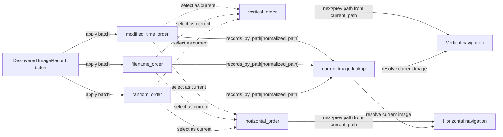
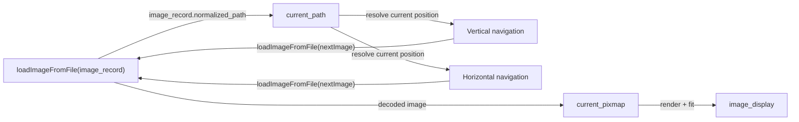

# Spec

Yee 3 should open folders containing tens of thousands of images quickly and keep image-to-image navigation responsive, including on high-latency storage such as NAS.
Navigation and order switching remain available during incremental loading.

## Folder Scans

Each scan completes after one directory pass and makes discovered images available for browsing as it progresses.
Changes detected during a scan prompt the user to reload manually. They never restart the scan or schedule an automatic follow-up.
A change notification received after completion may start a new scan when no manual reload is pending.

## Order Model

A folder is one collection of image records (`ImageRecord`) with three maintained orders.

Base order sets:
- `modified_time_order`: newest-first order by file modified time
- `filename_order`: descending lexical order by file name
- `random_order`: stable pseudo-random order

Active navigation bindings:
- `vertical_order`: the order currently assigned to vertical navigation
- `horizontal_order`: the order currently assigned to horizontal navigation

Each axis uses its selected order independently. Equal sort keys are resolved by path.
Up and left move toward the end of the selected order. Down and right move toward its start.
Arrow keys and scrolling use the same directions for image navigation. When the zoomed image can pan along the scroll axis, scrolling pans within the image.

## Current Image State

- `current_path`: the identity of the currently displayed image
- `current_pixmap`: the decoded base image used for rendering and scale calculations

`loadImageFromFile(image_record)` updates both values after decoding succeeds.

## Complexity Constraints

Let `N` be the number of indexed images and `D` the number of directory entries.

- A directory pass examines `O(D)` entries and reads metadata for image candidates.
- Building an order incrementally is currently worst-case `O(N²)` because array insertion can shift existing entries. The target is `O(N log N)` for construction.
- The final removal pass in a successful rescan filters and relinks each order in `O(N)`.
- Looking up a path and following its previous or next link take average `O(1)` in the order index. These bounds cover index operations. Image I/O and decoding have their own costs.
- Switching either axis to a different order takes `O(1)`.
